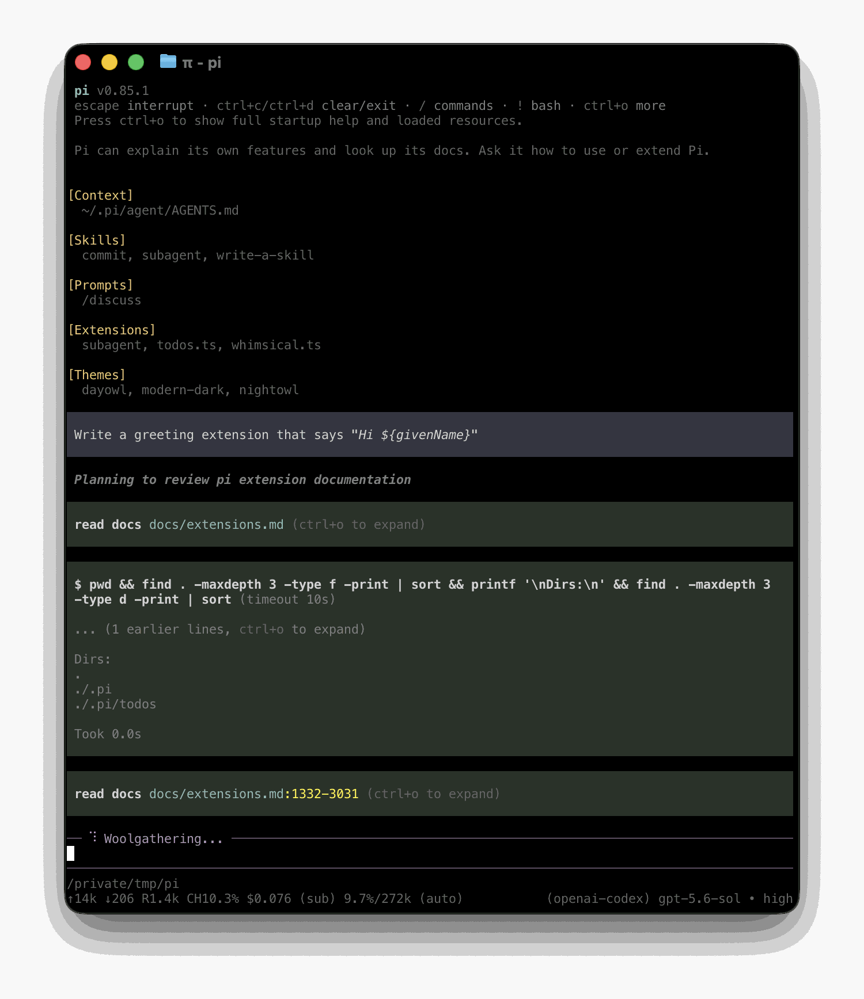

# Quickstart

nanopi runs in your terminal and works with files on your machine. To use it, you need access to a model through a supported provider. This can be a subscription, an API key, or a local model.

For native Windows setup, read [Windows Setup](windows.md). For Android, read [Termux Setup](termux.md).

## 1. Install nanopi

The bundle installs with one command and needs no registry account. This requires
Node.js 24 or newer:

```bash
curl -fsSL https://raw.githubusercontent.com/NekoSekaiMoe/nanopi/main/install.js | node
```

It writes the bundle and a `nanopi` shim into `~/.local/bin`; the installer prints a
note when that directory is not on `PATH`.

The npm package lives in GitHub Packages, which only serves authenticated clients.
To install that way, put the registry and a token with `read:packages` in `~/.npmrc`:

```text
@nekosekaimoe:registry=https://npm.pkg.github.com
//npm.pkg.github.com/:_authToken=${GITHUB_TOKEN}
```

```bash
npm install -g --ignore-scripts @nekosekaimoe/nanopi
```

Docker users can pull `ghcr.io/nekosekaimoe/nanopi` instead; see
[Containerization](containerization.md).

nanopi does not require dependency lifecycle scripts for a normal npm installation.

Verify the installation:

```bash
nanopi --version
```

## 2. Start nanopi

Change to the folder you want nanopi to work with, then start it:

```bash
cd /path/to/folder
nanopi
```

The working folder helps nanopi discover relevant files, instructions, and configuration. nanopi also uses it to group saved sessions.

<p align="center"></p>

The interface shows your conversation, an editor for prompts and commands, and a footer with the current folder, model, and session status. See [Use nanopi in the terminal](usage.md) to learn how to add files, run commands, direct ongoing work, and manage results.

## 3. Choose a model

A **model** generates nanopi's responses. A **provider** is the service or account nanopi uses to access that model.

In nanopi, run:

```text
/login
```

Choose a provider, then follow the prompts to use a subscription or store an API key. Run `/model` afterward if you want to select a different available model.

See [Choose a model and provider](models.md) for supported providers, environment-variable authentication, local models, and custom endpoints.

## 4. Give nanopi a task

nanopi shows each file read, search, command, and edit it performs. It does not ask before every tool call.

Enter a task that matches your work, for example:

```text
Summarize @meeting-notes.md and save the action items to action-items.md.
```

```text
Explain how this repository is structured and how to run its checks.
```

```text
Compare @previous.csv with @current.csv and summarize the important changes.
```

Type `@` in the editor to search for a file instead of entering its full path. When nanopi finishes, review its response and any changed files. Use version control or backups for important work. For untrusted or unattended work, use a container or another sandbox. See [Security](security.md).

## Continue later

nanopi saves sessions automatically. Exit nanopi, then resume the most recent session for the same working folder with:

```bash
nanopi --continue
```

Use `/resume` to choose another saved session. See [Continue or branch a session](sessions.md) for session naming, branching, compaction, export, and sharing.

## Next steps

- [Use nanopi interactively](usage.md) to learn input, commands, shortcuts, and queued messages.
- [Add instructions](configuration.md#context-files) that nanopi should follow whenever it works in a folder.
- [Choose a model and provider](models.md).

### Choose how to customize nanopi

Start with the least powerful mechanism that meets your need:

| Need | Start with |
|---|---|
| Give nanopi persistent instructions for a folder | [`AGENTS.md`](configuration.md#context-files) |
| Reuse a prompt from the `/` menu | [Prompt template](prompt-templates.md) |
| Add task-specific instructions and supporting files | [Skill](skills.md) |
| Build a custom terminal component | [Terminal UI](tui.md) |
| Connect an unsupported model service | [Custom provider](custom-provider.md) |
| Add a tool, command, shortcut, or event handler in code | [Modules](modules.md) |

## Uninstall nanopi

If you installed nanopi with npm, run:

```bash
npm uninstall -g @nekosekaimoe/nanopi
```


None of these methods removes configuration, credentials, or sessions from `~/.nanopi/agent/`.
